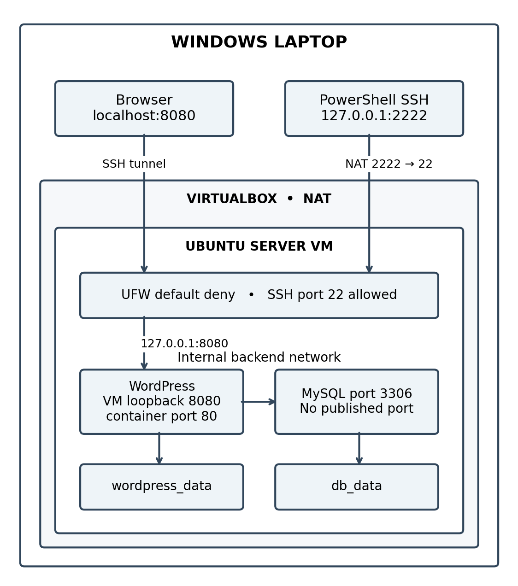

# Mission 10 — The Enterprise Cloud Architect

**Course:** CCM101 — Cloud Computing  
**Prepared by:** LAGUIT MARK KENNETH | DOMINGO ANDREKYLE | MAALA JOSHUA | FALINTAG JUNELLE | BULALAYAO RAIVEN  
**University:** University of Eastern Pangasinan  
**Section:** 4-J  
**Instructor:** Jenkielyn C. Torres

## Project overview

This laboratory project runs WordPress and MySQL in Docker containers inside an Ubuntu Server virtual machine. VirtualBox runs the VM on a Windows laptop. The design includes persistent storage, a UFW firewall, SSH access, scheduled backups and recovery procedures.

This is a single-VM laboratory deployment. It is not a highly available or independently certified production system.

## Architecture



| Component | Configuration |
|---|---|
| Host | Windows laptop |
| Virtualization | VirtualBox with NAT |
| Server | Ubuntu Server, hostname `ccm101-server` |
| Ubuntu user | `laguit` |
| Website | `wordpress:php8.3-apache` |
| Database | `mysql:8.4` |
| Persistent storage | `db_data` and `wordpress_data` |
| Administration | Windows `127.0.0.1:2222` forwarded to VM SSH port `22` |
| Web access | SSH tunnel to VM `127.0.0.1:8080` |
| Database access | Internal Docker backend network; no published MySQL port |
| Backup schedule | Daily at 02:00 in the VM timezone, once cron is configured |

## Files

| File | Purpose |
|---|---|
| [docker-compose.yml](docker-compose.yml) | Defines containers, volumes, networks and secrets |
| [automation-script.sh](automation-script.sh) | Creates a complete backup set |
| [operational-manual.md](operational-manual.md) | Installation, operation, security, troubleshooting and recovery |
| [final-reflection.md](final-reflection.md) | Reflection draft to personalize before submission |
| [architecture-diagram.png](architecture-diagram.png) | Planned local topology |
| `manual_assets/` | Earlier images referenced by the operational manual |
| `screenshots/` | Eight supplied deployment screenshots with captions in the manual |

## Prerequisites

Install Ubuntu Server in VirtualBox, Docker Engine, the Docker Compose plugin, OpenSSH Server, UFW, OpenSSL and Cron. Follow the [operational manual](operational-manual.md) for the complete procedure. Configure VirtualBox NAT forwarding from Windows port `2222` to Ubuntu port `22`.

Run the following commands in Ubuntu as `laguit`. Change the path if your repository is elsewhere.

```bash
cd ~/CCM101-mlaguit/Laboratory-10-Enterprise-Cloud-Architect
mkdir -p secrets backups
chmod 700 secrets backups
```

Generate passwords only when these files do not already exist:

```bash
test -e secrets/db_password.txt || openssl rand -hex 24 > secrets/db_password.txt
test -e secrets/db_root_password.txt || openssl rand -hex 24 > secrets/db_root_password.txt
chmod 644 secrets/db_password.txt
chmod 600 secrets/db_root_password.txt
```

The application password must be readable by WordPress inside its container. The host `secrets` directory remains private. Do not regenerate credentials after MySQL initializes; password-file changes do not update existing database accounts.

## Deploy

If the earlier temporary Nginx test container still exists, remove only that container first:

```bash
sudo docker rm -f connection-test
```

If it does not exist, skip that command. Start the final stack:

```bash
sudo docker compose config --quiet
sudo docker compose up -d
sudo docker compose ps -a
```

In a separate **Windows PowerShell** window, run:

```powershell
ssh -N -L 8080:127.0.0.1:8080 -p 2222 laguit@127.0.0.1
```

Keep that window open and visit **http://localhost:8080**. Complete the WordPress installation using your own administrator credentials. Keep the browser URL consistent because WordPress stores its site address.

## Security

Inside Ubuntu, allow SSH before enabling UFW:

```bash
sudo ufw default deny incoming
sudo ufw default allow outgoing
sudo ufw allow 22/tcp
sudo ufw enable
sudo ufw status verbose
```

WordPress is published only on the VM loopback address. MySQL is not published to the host. Docker-published ports can bypass UFW rules, so public exposure needs a separate review. Keep `secrets/`, `backups/`, `.env` and logs out of GitHub. Review browser uploads manually; `.gitignore` does not block a manual upload of a sensitive file.

## Verify persistent storage

Create a WordPress post titled **Persistence Test**, then run:

```bash
sudo docker compose down
sudo docker compose up -d
```

Confirm the post remains. Repeat after a VM reboot and reconnect the SSH tunnel. Do not use `down -v`, because it removes named volumes.

## Backups

The script briefly stops WordPress, exports MySQL, archives the WordPress files, copies the Compose configuration and secrets, and starts WordPress again. This causes a short planned interruption.

```bash
chmod +x automation-script.sh
bash -n automation-script.sh
sudo ./automation-script.sh
sudo ls -lh backups
```

A completed backup directory contains `database.sql.gz`, `wordpress-files.tar.gz`, `docker-compose.yml`, `secrets/` and a `COMPLETE` marker. Backups contain credentials and must remain private. Copy completed backup sets to encrypted storage outside the VM.

Set the timezone and open root's crontab:

```bash
sudo timedatectl set-timezone Asia/Manila
sudo systemctl enable --now cron
sudo crontab -e
```

Add these two lines, keeping the schedule on one physical line:

```cron
PROJECT=/home/laguit/CCM101-mlaguit/Laboratory-10-Enterprise-Cloud-Architect
0 2 * * * "$PROJECT/automation-script.sh" >> /var/log/ccm101-backup.log 2>&1
```

The VM must be running at the scheduled time. Confirm an actual scheduled run using its log and new backup directory.

## Recovery

Follow the [operational manual](operational-manual.md) to import an SQL backup into a separate test database and to recover the full website on a fresh replacement VM. Validate posts, images, administrator login and the site URL before accepting recovery.

## Troubleshooting

```bash
sudo docker compose ps -a
sudo docker compose logs --tail=50 wordpress
sudo docker compose logs --tail=50 db
```

- **Docker socket permission denied:** use `sudo` for Docker commands.
- **SSH permission denied:** use Ubuntu username `laguit` and its password.
- **Database connection error:** check the password-file permissions, database credentials and shared network. A healthy MySQL ping does not prove WordPress can authenticate.
- **Browser unavailable:** confirm the VM, containers and Windows SSH tunnel are running.

## Evidence and test status

The [manual](operational-manual.md#deployment-screenshots) includes eight additional screenshots showing Ubuntu login, NAT forwarding, SSH access, MySQL healthy and WordPress running, a working dashboard, published posts and a successful manual database-only backup. Earlier firewall and troubleshooting evidence is retained. Persistence after reboot, scheduled execution and recovery still need verification.

- [x] SSH and firewall screenshots included.
- [x] Nginx connection-test screenshots included.
- [x] Successful WordPress dashboard screenshot included.
- [x] Both final containers running; MySQL healthy.
- [x] Published post and manual SQL backup screenshots included.
- [ ] Verify persistence after recreation and reboot.
- [ ] Verify a complete backup and actual scheduled execution.
- [ ] Verify SQL import and full website recovery.
- [ ] Rehearse deployment on a fresh KillerCoda instance.
- [ ] Review the group details and personalize the reflection.

## Sources and AI assistance

- [Docker installation on Ubuntu](https://docs.docker.com/engine/install/ubuntu/)
- [Docker Compose secrets](https://docs.docker.com/compose/how-tos/use-secrets/)
- [Docker and firewall behavior](https://docs.docker.com/engine/network/packet-filtering-firewalls/)
- [Ubuntu Server installation](https://ubuntu.com/tutorials/install-ubuntu-server)
- [MySQL backup reference](https://dev.mysql.com/doc/refman/8.4/en/mysqldump.html)

AI assisted with drafting these instructions and troubleshooting setup issues. The student must review the commands, perform the tests, document actual results and follow the instructor's disclosure requirements.
