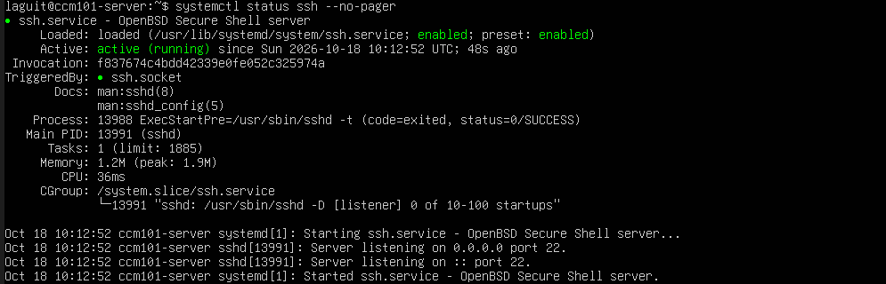
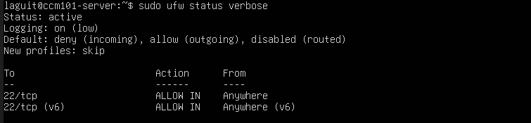
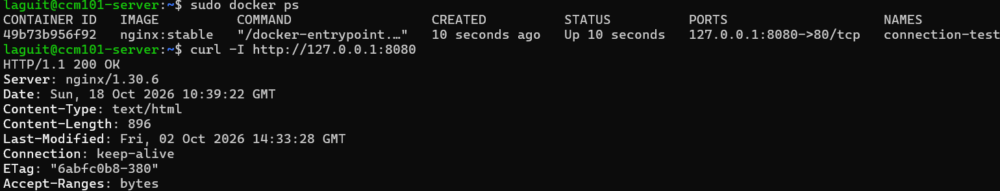
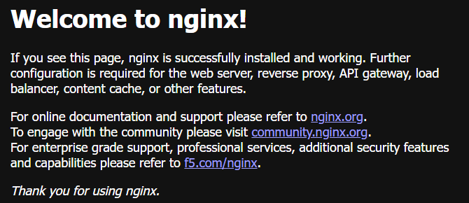

# Enterprise Cloud Architect Operational Manual

Secure WordPress and MySQL on Ubuntu Server

CCM101 - Cloud Computing 
Enterprise Cloud Architect – Operational Manual 
Project: Secure Multi-Tier Web Application
Application Stack: WordPress + MySQL 
Prepared by
LAGUIT MARK KENNETH | DOMINGO ANDREKYLE | MAALA JOSHUA | FALINTAG JUNELLE | BULALAYAO RAIVEN
Section: 4-J
Instructor: Jenkielyn C. Torres
Date: 18 October 2026
This manual explains how to install, connect, deploy, secure, back up and recover the project. It includes screenshots supplied during setup and commands corrected for the Ubuntu account laguit.
Verification status: SSH, UFW and the Nginx browser test are shown in screenshots. A 240 KB database backup was reported. Successful WordPress installation, scheduled execution and full recovery still require evidence. This is a laboratory baseline, not a certified production environment.

# Contents and command locations

Foundation and architecture

Install VirtualBox and Ubuntu

Configure SSH and the firewall

Connect from Windows and test Docker

Deploy WordPress and MySQL

Verify the website and persistent storage

Automate complete backups

Restore and verify recovery

Maintain and troubleshoot the system

Prepare GitHub and the live defense

Evidence checklist and references

| Prompt or location | What to run there |
|---|---|
| PS C:\Users\markk> | Windows SSH and file transfer commands |
| laguit@ccm101-server:~$ | Ubuntu commands; use sudo for Docker |
| root@ccm101-server:~# | Administrative shell; sudo is optional |
| SSH tunnel window | Leave open; do not type Linux commands into it |

Copy commands only, without the prompt. The symbol ~ means the current user’s home directory. After sudo -i it means /root, so use the full project path shown in recovery steps.

# Foundation and architecture

The Windows laptop runs VirtualBox. VirtualBox hosts Ubuntu Server. Ubuntu runs Docker Engine, WordPress and MySQL. Windows reaches Ubuntu SSH through a local NAT forwarding rule. A separate SSH tunnel carries browser traffic to WordPress.

| Layer | Configuration |
|---|---|
| Host | Windows laptop and browser |
| Hypervisor | VirtualBox with NAT networking |
| Guest | Ubuntu Server; hostname ccm101-server |
| Administration | 127.0.0.1:2222 on Windows → VM port 22 |
| Website | Windows tunnel 8080 → VM 127.0.0.1:8080 |
| Containers | WordPress port 80; MySQL port 3306 |
| Storage | db_data and wordpress_data named volumes |
| Security | UFW default deny incoming; allow SSH |
| Automation | Root cron runs a daily backup at 02:00 |

MySQL has no published host port. The internal backend network joins it to WordPress. WordPress also has a frontend network for outbound access. Backups must be copied outside the VM to survive loss of its disk.

The diagram on the next page shows this topology: Windows host enclosing VirtualBox, Ubuntu VM enclosing UFW and Docker, then WordPress and MySQL with their two volumes. Label SSH 2222 → 22 and the browser tunnel. Use the included architecture-diagram.png in your GitHub folder and update it if your actual configuration changes.

# Architecture diagram


# Install VirtualBox and Ubuntu

1. On Windows, download VirtualBox from virtualbox.org/wiki/Downloads and an Ubuntu Server amd64 LTS ISO from ubuntu.com/download/server. Use an Ubuntu release supported by Docker’s current Ubuntu installation page [1–3].

2. Install VirtualBox. Select New, name the VM ccm101-server, select the Ubuntu ISO, and skip unattended installation so you can follow the installer.

3. Allocate 2 virtual CPUs, 4 GB RAM where available, and a 30 GB dynamically allocated disk. Leave enough memory for Windows. Select NAT for Adapter 1.

4. Start the VM. Choose language and keyboard layout. Keep automatic DHCP networking, leave proxy blank unless required, and keep the default package mirror.

5. Select the new virtual disk for guided storage. Confirm its size before accepting erasure. The target must be the VM disk, not a physical Windows disk.

6. Create your profile: your own name, server ccm101-server, username laguit, and a private password. On SSH Setup, select Install OpenSSH server with Spacebar. Select Done.

7. Skip optional featured packages, finish installation and reboot. Eject the ISO when prompted. Log in with laguit and your Ubuntu password. Password characters are invisible while typing.

Capture needed: VM hardware settings and the Ubuntu login prompt. Do not photograph passwords.

# Configure SSH and the firewall

Run inside the Ubuntu VM console. Install SSH here if it was not selected during installation [2].

```bash
sudo apt update
sudo apt upgrade -y
sudo apt install -y openssh-server ufw curl
sudo apt install -y ca-certificates nano openssl cron
sudo systemctl enable --now ssh
sudo systemctl enable --now cron
systemctl status ssh --no-pager
```

Allow SSH before enabling the firewall. Port 22 is the port inside Ubuntu; 2222 is the Windows forwarding port.

```bash
sudo ufw default deny incoming
sudo ufw default allow outgoing
sudo ufw allow 22/tcp
sudo ufw enable
sudo ufw status verbose
```

Expected: SSH active (running), UFW active, default deny incoming, and 22/tcp allowed. Docker-published ports can bypass UFW [4]; this design publishes the web port only on VM loopback and does not publish MySQL.

The local setup uses an encrypted SSH tunnel for browser access. Public hosting would additionally need HTTPS, stronger identity controls, monitoring and a reviewed exposure policy.

# SSH and firewall evidence





These screenshots confirm the observed local state at capture time. Repeat the status checks after any firewall or SSH configuration change.

The earlier sudu and sudoufw errors were typing mistakes. Use sudo followed by a space, then the command.

# Connect Windows to Ubuntu

1. Shut down the VM using sudo poweroff. In VirtualBox Manager, open Settings → Network → Adapter 1 → NAT → Advanced → Port Forwarding [3].

| Field | Value |
|---|---|
| Name | SSH |
| Protocol | TCP |
| Host IP | 127.0.0.1 |
| Host Port | 2222 |
| Guest IP | Leave blank |
| Guest Port | 22 |

2. Save the rule and start the VM. In Windows PowerShell, connect:

```bash
ssh -p 2222 laguit@127.0.0.1
```

3. For a new host-key prompt, compare the shown fingerprint with this output from the VM console:

```bash
sudo ssh-keygen -lf \
  /etc/ssh/ssh_host_ed25519_key.pub
```

Accept only a matching fingerprint, then enter your Ubuntu password. The prompt should become laguit@ccm101-server. Keep the VM running. Use laguit, not the earlier example username markkenneth.

# Install Docker Engine

Run in Ubuntu. These commands are for a fresh Ubuntu installation using Docker’s official repository [1]. Existing conflicting Docker packages should be reviewed against the official instructions before removal.

```bash
sudo install -m 0755 -d /etc/apt/keyrings
sudo curl -fsSL \
  https://download.docker.com/linux/ubuntu/gpg \
  -o /etc/apt/keyrings/docker.asc
sudo chmod a+r /etc/apt/keyrings/docker.asc
```

```bash
sudo tee /etc/apt/sources.list.d/docker.sources \
  > /dev/null <<EOF
Types: deb
URIs: https://download.docker.com/linux/ubuntu
Suites: $(. /etc/os-release && echo "$VERSION_CODENAME")
Components: stable
Architectures: $(dpkg --print-architecture)
Signed-By: /etc/apt/keyrings/docker.asc
EOF
```

```bash
sudo apt update
sudo apt install -y docker-ce docker-ce-cli \
  containerd.io docker-buildx-plugin \
  docker-compose-plugin
sudo systemctl enable --now docker
sudo docker --version
sudo docker compose version
sudo docker run --rm hello-world
```

Expected: version numbers and Hello from Docker! Docker Desktop on Windows is separate from this VM’s Docker Engine. Use sudo docker ps -a to see the VM containers.

# Test browser access

In Ubuntu, start a temporary Nginx container:

```bash
sudo docker run -d --name connection-test \
  -p 127.0.0.1:8080:80 nginx:stable
sudo docker ps
curl -I http://127.0.0.1:8080
```

Expected: HTTP/1.1 200 OK. In a NEW Windows PowerShell tab with a PS prompt, start the tunnel:

```bash
ssh -N -L 8080:127.0.0.1:8080 -p 2222 laguit@127.0.0.1
```

PowerShell instruction: enter the SSH command above on ONE line. Leave the tunnel window open after entering the password. No output is normal.

Browse to http://localhost:8080. If Windows port 8080 is occupied, replace only the first 8080 in the tunnel with 8081 and browse localhost:8081. Keep that address consistent for WordPress.

After capturing the successful page, remove only the test container in Ubuntu so WordPress can use port 8080:

```bash
sudo docker rm -f connection-test
```

# Browser connection evidence





This proves the test web server responded. It does not prove WordPress or its database works. The test container is removed before deploying the final application.

# Create project files and secrets

Run in Ubuntu as laguit. Use this directory for all subsequent Compose commands.

```bash
mkdir -p ~/CCM101-mlaguit
cd ~/CCM101-mlaguit
mkdir -p Laboratory-10-Enterprise-Cloud-Architect
cd Laboratory-10-Enterprise-Cloud-Architect
mkdir -p secrets backups
chmod 700 secrets backups
```

Generate each password only if its file does not already exist. Do not regenerate passwords for an initialized database.

```bash
test -e secrets/db_password.txt || \
  openssl rand -hex 24 > secrets/db_password.txt
test -e secrets/db_root_password.txt || \
  openssl rand -hex 24 > secrets/db_root_password.txt
chmod 644 secrets/db_password.txt
chmod 600 secrets/db_root_password.txt
```

The WordPress web process must read the mounted application password. Mode 644 permits this inside the container; mode 700 on the host secrets directory prevents other ordinary host users from traversing it. The root password is mounted only into MySQL. Compose file secrets are bind mounts, not an encrypted secret vault [5].

Create .gitignore with the following entries. Never commit these secret files or database dumps.

```bash
secrets/
backups/
.env
*.log
```

# Compose database service

Open nano docker-compose.yml. Paste this section, then append the next page directly below it. Both pages form ONE YAML file. Preserve indentation.

```bash
name: ccm101-cloud
services:
  db:
    image: mysql:8.4
    restart: unless-stopped
    environment:
      MYSQL_DATABASE: wordpress
      MYSQL_USER: wordpress
      MYSQL_PASSWORD_FILE: /run/secrets/db_password
      MYSQL_ROOT_PASSWORD_FILE: >-
        /run/secrets/db_root_password
    secrets:
      - db_password
      - db_root_password
    volumes:
      - db_data:/var/lib/mysql
    networks:
      - backend
    healthcheck:
      test:
        - CMD-SHELL
        - mysqladmin ping -h 127.0.0.1 --silent
      interval: 10s
      timeout: 5s
      retries: 15
      start_period: 30s
```

A healthy ping confirms that the server responds, not that WordPress has the correct password. MySQL data lives in db_data and survives container replacement [6].

# Compose website and storage

```bash
  wordpress:
    image: wordpress:php8.3-apache
    restart: unless-stopped
    depends_on:
      db:
        condition: service_healthy
    ports:
      - "127.0.0.1:8080:80"
    environment:
      WORDPRESS_DB_HOST: db:3306
      WORDPRESS_DB_NAME: wordpress
      WORDPRESS_DB_USER: wordpress
      WORDPRESS_DB_PASSWORD_FILE: >-
        /run/secrets/db_password
    secrets:
      - db_password
    volumes:
      - wordpress_data:/var/www/html
    networks:
      - frontend
      - backend
secrets:
  db_password:
    file: ./secrets/db_password.txt
  db_root_password:
    file: ./secrets/db_root_password.txt
volumes:
  db_data:
  wordpress_data:
networks:
  frontend:
  backend:
    internal: true
```

Save in nano: Ctrl+O, Enter, Ctrl+X. The complete copyable YAML file is docker-compose.yml in this folder.

# Start and configure WordPress

```bash
sudo docker compose config --quiet
sudo docker compose up -d
sudo docker compose ps -a
```

The first start downloads images and initializes MySQL. Wait for db to become healthy and wordpress to run. Keep the Windows SSH tunnel open and browse http://localhost:8080.

On the WordPress setup page, choose English, enter a site title such as CCM101 Cloud Project, choose an administrator username and a strong password, then enter your email. Click Install WordPress and log in. This administrator account is separate from your Ubuntu and database accounts.

If the database connection error appears, use the troubleshooting pages before reinstalling anything. Successful installation has not yet been verified in the supplied evidence.

## Test persistent storage

Create and publish a WordPress post titled Persistence Test. Record its content, then run:

```bash
sudo docker compose down
sudo docker compose up -d
```

Refresh the site and confirm the same post remains. Do not add -v; it deletes named volumes. Also reboot the VM, reconnect the SSH tunnel and verify the post again.

Capture needed: installer, dashboard, two running containers, and the same post before and after recreation and reboot.

# Database connection troubleshooting

A healthy MySQL container can still reject WordPress credentials. Start by checking the web process can read its password [5,7].

```bash
sudo docker compose exec --user www-data \
  wordpress sh -c \
  'test -r /run/secrets/db_password && \
  echo READABLE || echo NOT_READABLE'
```

If NOT_READABLE appears, correct only the application secret permissions:

```bash
chmod 700 secrets
chmod 644 secrets/db_password.txt
sudo docker compose restart wordpress
```

Refresh the page. If the error remains, collect the precise error without displaying passwords:

```bash
sudo docker compose ps -a
sudo docker compose logs --tail=50 wordpress
sudo docker compose logs --tail=50 db
```

Access denied usually means credentials or grants differ. Unknown database means the expected database is absent. Connection refused or name-resolution errors require checking the db service and shared backend network. If password files were regenerated, recover the original credentials or perform an authenticated password change; changing environment variables does not reset an existing database.

Do not delete the database volume to bypass an error. Preserve evidence and backups before a credential recovery or rebuild.


# Backup script preparation

```bash
#!/usr/bin/env bash
set -Eeuo pipefail
umask 077
export PATH=/usr/sbin:/usr/bin:/sbin:/bin
SCRIPT_DIR="$(dirname -- "${BASH_SOURCE[0]}")"
PROJECT_DIR="$(cd -- "$SCRIPT_DIR" && pwd)"
cd "$PROJECT_DIR"
mkdir -p backups
exec 9>backups/.backup.lock
flock -n 9 || exit 0
STAMP="$(date +%Y-%m-%d_%H-%M-%S)"
DEST="$PROJECT_DIR/backups/$STAMP"
mkdir "$DEST"
RESTART=0
cleanup() {
  result=$?
  trap - EXIT
  if [ "$RESTART" = 1 ]; then
    docker compose start wordpress || result=1
  fi
  if [ "$result" != 0 ]; then
    echo "$(date -Is) BACKUP FAILED: $DEST" >&2
  fi
  exit "$result"
}
trap cleanup EXIT
# Only run when WordPress is already running.
RUNNING="$(docker compose ps --status running -q wordpress)"
test -n "$RUNNING"
RESTART=1
docker compose stop wordpress
```

# Backup script capture and finish

```bash
docker compose exec -T db sh -c '
  export MYSQL_PWD="$(cat /run/secrets/db_root_password)"
  exec mysqldump --user=root --single-transaction \
    --quick --no-tablespaces --set-gtid-purged=OFF \
    wordpress
' | gzip > "$DEST/database.sql.gz"
gzip -t "$DEST/database.sql.gz"
docker compose run --rm --no-deps -T \
  --entrypoint tar wordpress \
  -C /var/www/html -czf - . \
  > "$DEST/wordpress-files.tar.gz"
tar -tzf "$DEST/wordpress-files.tar.gz" > /dev/null
cp docker-compose.yml "$DEST/"
cp -a secrets "$DEST/"
docker compose start wordpress
RESTART=0
touch "$DEST/COMPLETE"
echo "$(date -Is) BACKUP SUCCESS: $DEST"
```

Save, check syntax and run manually:

```bash
chmod +x automation-script.sh
bash -n automation-script.sh
sudo ./automation-script.sh
sudo ls -lh backups
```

Open the newest directory as root and confirm COMPLETE exists. Archive validation checks file integrity, not full application recovery. Perform the restore test as well.

# Schedule and verify automation

```bash
sudo timedatectl set-timezone Asia/Manila
timedatectl
sudo systemctl enable --now cron
sudo crontab -e
```

In root’s crontab, add the following TWO lines. The schedule line must remain one physical line. PROJECT keeps the path manageable.

```bash
PROJECT=/home/laguit/CCM101-mlaguit/Laboratory-10-Enterprise-Cloud-Architect
0 2 * * * "$PROJECT/automation-script.sh" >> /var/log/ccm101-backup.log 2>&1
```

The document may wrap long lines visually; copy the ready-made cron-example.txt from the source package to avoid introducing line breaks. Cron runs daily at 02:00 in the VM timezone [9]. The VM must be running; a missed cron run is not automatically replayed.

```bash
sudo crontab -l
sudo systemctl status cron --no-pager
sudo tail -n 30 /var/log/ccm101-backup.log
```

To test scheduling, temporarily use a time a few minutes ahead, observe a new COMPLETE backup and a success log, then restore 0 2 * * *. Capture the schedule, log and new backup directory. Do not claim that merely saving the crontab proves execution.

If the filename timestamp differs from the ls display, check the timezone used when the backup was created. The reported earlier name 11-21-08 and displayed 19:21 reflect an eight-hour offset; use the filename exactly as stored.

# Restore the existing SQL backup

This non-destructive test uses the database-only file reported in the conversation. It checks SQL import, not complete site recovery. Use a new test database name if restore_test already holds valuable data.

```bash
sudo -i
cd /home/laguit/CCM101-mlaguit
cd Laboratory-10-Enterprise-Cloud-Architect
BACKUP_FILE="backups/wordpress_2026-10-18_11-21-08.sql.gz"
gzip -t "$BACKUP_FILE"
```

```bash
docker compose exec -T db sh -c '
  export MYSQL_PWD="$(cat /run/secrets/db_root_password)"
  mysql -u root -e "CREATE DATABASE restore_test;"
'
```

```bash
set -o pipefail
gzip -dc "$BACKUP_FILE" | \
  docker compose exec -T db sh -c '
  export MYSQL_PWD="$(cat /run/secrets/db_root_password)"
  mysql -u root restore_test
'
```

```bash
docker compose exec -T db sh -c '
  export MYSQL_PWD="$(cat /run/secrets/db_root_password)"
  mysql -u root -e "SHOW TABLES FROM restore_test;"
'
exit
```

Expected: WordPress tables appear. Record the command exit status and table list. The provided filename and size alone do not prove restoration succeeded.

# Recover the complete site

Perform this rehearsal in a fresh replacement VM or isolated clone. The imports below replace target site files and database contents. Keep the original VM and backup intact until verification passes.

1. Install Ubuntu and Docker using the earlier pages. Secure SSH/UFW and recreate the Windows forwarding rule for this VM. Transfer a completed backup set from protected external storage. Do not run both VMs on the same Windows forwarding port.

2. In the replacement VM, enter root. Set SET to the actual extracted backup directory. Restore its configuration and secrets:

```bash
sudo -i
SET=/root/recovery-set
test -f "$SET/COMPLETE"
mkdir -p /home/laguit/CCM101-mlaguit
cd /home/laguit/CCM101-mlaguit
mkdir -p Laboratory-10-Enterprise-Cloud-Architect
cd Laboratory-10-Enterprise-Cloud-Architect
cp "$SET/docker-compose.yml" .
cp -a "$SET/secrets" .
chmod 700 secrets
chmod 644 secrets/db_password.txt
chmod 600 secrets/db_root_password.txt
docker compose up -d db
docker compose ps
```

3. Wait for MySQL to become healthy. Continue on the next page. If an existing target volume has different credentials, do not overwrite it blindly; recover into fresh volumes on the replacement VM.

# Import and validate the recovered site

Continue in the same root shell so SET remains defined. Import the database and restore the WordPress files before starting the website.

```bash
set -o pipefail
gzip -dc "$SET/database.sql.gz" | \
  docker compose exec -T db sh -c '
  export MYSQL_PWD="$(cat /run/secrets/db_root_password)"
  mysql -u root wordpress
'
```

```bash
docker compose run --rm --no-deps -T \
  --entrypoint tar wordpress \
  -C /var/www/html -xzf - \
  < "$SET/wordpress-files.tar.gz"
docker compose up -d
docker compose ps -a
```

Reconnect the Windows SSH tunnel and use the original browser URL. WordPress stores its URL in the database; using the same localhost port avoids a URL mismatch during this rehearsal.

Verify login, the Persistence Test post, an uploaded image, theme appearance and plugin availability. Capture the recovered page and container status. Record the start and finish times and any data missing since the backup.

If verification fails, retain the original VM and backup, inspect logs and repeat the rehearsal on the replacement system. Do not delete the original volumes until a complete recovery is verified.

Restore the script and cron schedule from your reviewed repository. Run a new backup from the recovered site. Store passwords privately and apply normal project ownership before returning to the laguit account.

# Daily operation and maintenance

| Task | Ubuntu command |
|---|---|
| List containers | sudo docker compose ps -a |
| View recent logs | sudo docker compose logs --tail=50 |
| Check resource use | sudo docker stats --no-stream |
| Check disk | df -h |
| Check Docker disk | sudo docker system df |
| Check firewall | sudo ufw status verbose |
| Stop services | sudo docker compose stop |
| Start services | sudo docker compose start |

Run Compose commands from the project directory. Reconnect the Windows SSH tunnel after reboot or disconnection. If the tunnel is closed, localhost access stops even while containers continue running.

Before an update, create and copy a complete backup off the VM. Record current image IDs with sudo docker compose images and inspect release notes. Test updates on a clone before applying them to the main lab.

```bash
sudo docker compose pull
sudo docker compose up -d
sudo docker compose ps -a
```

Image tags can change over time. Record tested image digests in the final handover for reproducibility. A database upgrade may change its files; rollback should use the verified backup and compatible image version, not an assumed safe downgrade.

# Prepare the GitHub handover

Your final folder should contain README.md, architecture-diagram.png, docker-compose.yml, automation-script.sh, operational-manual.md and final-reflection.md. Add .gitignore and a screenshots folder. The source package includes the manual, Compose file, backup script, cron example and selected screenshot crops.

Write README.md with your chosen stack, design decisions, tested environment, startup instructions and evidence links. Write final-reflection.md in your own words using actual problems and lessons from Missions 1–10; do not claim unperformed tests.

To copy reviewed non-secret files to Windows, run these in a NEW PowerShell window. Use each command on one line:

```bash
scp -P 2222 laguit@127.0.0.1:/home/laguit/CCM101-mlaguit/Laboratory-10-Enterprise-Cloud-Architect/docker-compose.yml .
scp -P 2222 laguit@127.0.0.1:/home/laguit/CCM101-mlaguit/Laboratory-10-Enterprise-Cloud-Architect/automation-script.sh .
```

Upload the selected files into your existing GitHub Mission 10 folder using Add file → Upload files, review the changes and commit. Do not upload the entire project directory without checking for secrets and backups. A .gitignore file does not prevent you manually uploading secrets through a browser.

Print this manual at actual size on 5.5 × 8.5-inch portrait paper. Fill in your section and replace pending evidence with your own successful results before submission.

# Practice the live defense

Your assignment requires both the local Ubuntu VM and a fresh KillerCoda deployment. KillerCoda is temporary; preserve code and evidence in GitHub before the session ends. Its session access and exposed-port URL differ from Windows NAT [10].

On a fresh session, inspect the OS, Docker and Compose versions. Retrieve the reviewed repository, generate NEW secrets for the NEW database, apply the application password permissions, validate Compose and launch the stack. Do not reuse real passwords.

The local Compose file intentionally binds WordPress to 127.0.0.1. For browser access through a platform port URL, use a host reverse proxy listening on the chosen web port and forwarding to 127.0.0.1:8080, then use the platform’s exposed-port interface. Configure the proxy Host header and WordPress site URL for that platform URL. Confirm HTTPS forwarding behavior where the platform terminates TLS.

Do not simply expose MySQL or assume UFW filters Docker’s published ports. Before enabling default-deny in a remote playground, identify the platform’s required administration access and preserve it. Rehearse this environment-specific exposure policy in advance; it has not been tested in the supplied screenshots.

Demonstrate: two containers, a working post, persistence after recreation, UFW policy, a successful backup, a restored record and the cron schedule. Explain which commands run on the Windows host and which run inside Ubuntu.

For public or enterprise use, extend this lab with HTTPS, SSH keys and reviewed access restrictions, off-host backups, alerting, patch policy and tested availability controls. This single-VM design is not highly available.

# Evidence and completion checklist

| Evidence | Status in this manual |
|---|---|
| VM installation and topology | VM capture needed; planned diagram included |
| SSH active and UFW rules | Included in Figures 1 and 2 |
| Nginx HTTP and browser test | Included in Figures 3 and 4 |
| WordPress connection error | Included in Figure 5 as troubleshooting evidence |
| WordPress dashboard | Successful capture needed |
| Two containers healthy/running | Reported in chat; screenshot needed |
| Post after reboot/recreation | Capture needed |
| Database backup file | 240 KB file reported; validation needed |
| Cron execution and log | Capture needed |
| SQL restore tables | Capture needed |
| Complete recovered site | Capture needed |
| Fresh KillerCoda deployment | Rehearsal and capture needed |

For each new screenshot, include the command or browser URL where useful, the meaningful result and the capture date. Exclude passwords, tokens and unrelated personal material. Do not label an expected result as a completed test.

Suggested disclosure: AI assisted with drafting and troubleshooting this manual. I reviewed the commands, performed the documented tests, and added my own evidence and analysis. Use this statement only after it accurately describes your work and follow your instructor’s disclosure rules.

# References

[1] Docker Engine on Ubuntu

https://docs.docker.com/engine/install/ubuntu/

[2] Ubuntu Server installation and OpenSSH

https://ubuntu.com/tutorials/install-ubuntu-server
https://ubuntu.com/server/docs/openssh-server/

[3] VirtualBox networking and downloads

https://docs.oracle.com/en/virtualization/virtualbox/7.2/user/networkingdetails.html
https://www.virtualbox.org/wiki/Downloads

[4] Docker packet filtering and port publishing

https://docs.docker.com/engine/network/packet-filtering-firewalls/
https://docs.docker.com/engine/network/port-publishing/

[5] Compose secrets and service configuration

https://docs.docker.com/compose/how-tos/use-secrets/
https://docs.docker.com/reference/compose-file/services/

[6] Docker WordPress example

https://github.com/docker/awesome-compose/tree/master/official-documentation-samples/wordpress

[7] Official WordPress image configuration

https://github.com/docker-library/wordpress/blob/master/wp-config-docker.php

[8] MySQL mysqldump reference

https://dev.mysql.com/doc/refman/8.4/en/mysqldump.html

[9] Ubuntu shell-script backups and cron

https://ubuntu.com/server/docs/reference/backups/

[10] KillerCoda platform

https://killercoda.com/

Source note: official documentation informed the commands and explanations. Screenshots are supplied by the user on 18 October 2026 and cropped to the relevant application or terminal area. Classroom requirements come from the user-provided Mission 10 brief. Recheck current platform and package documentation before deployment.
